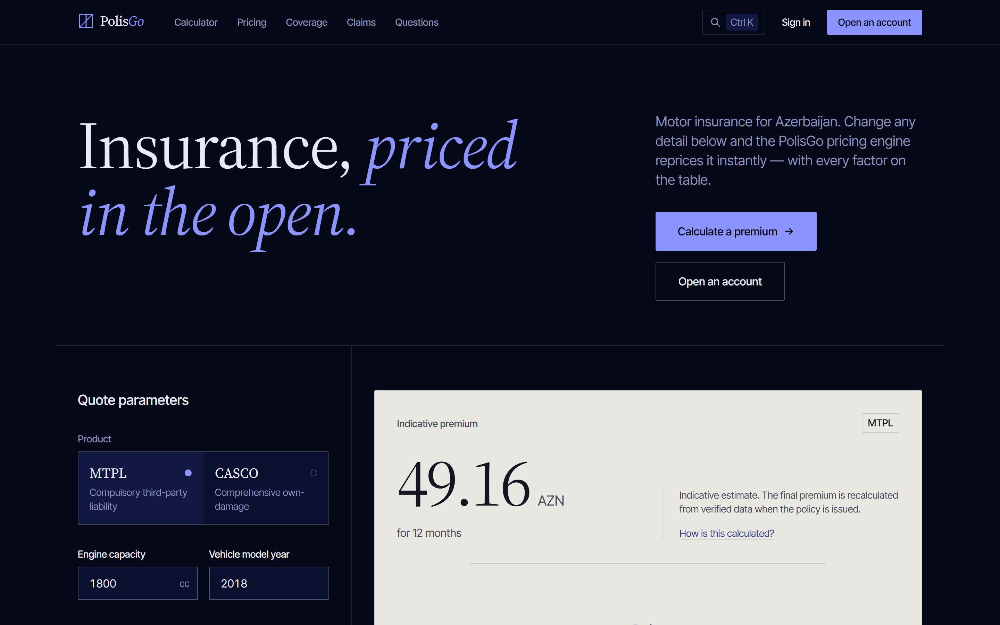
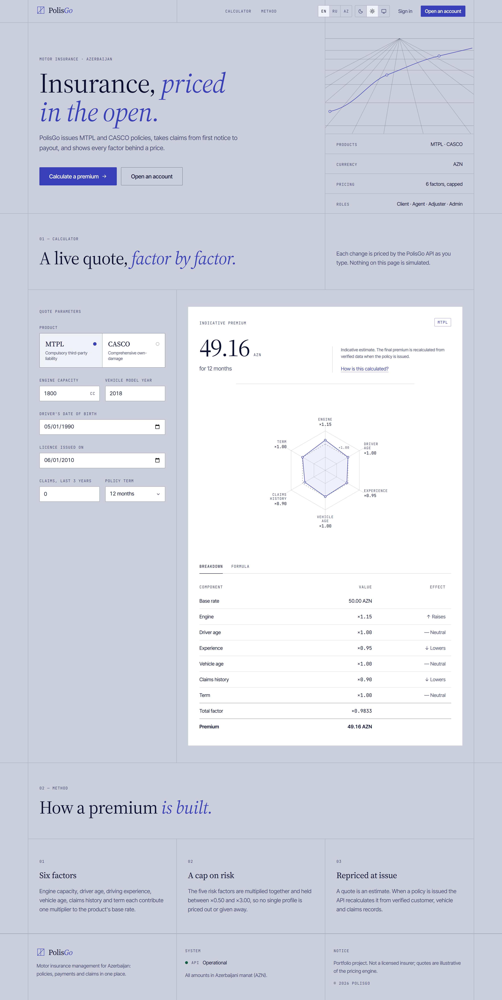
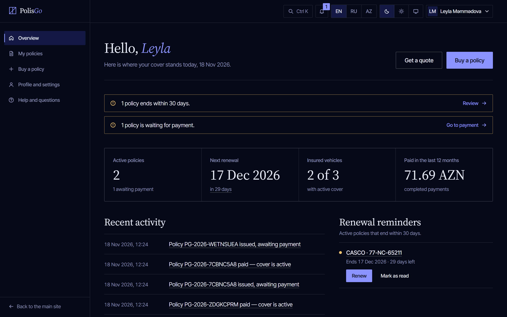
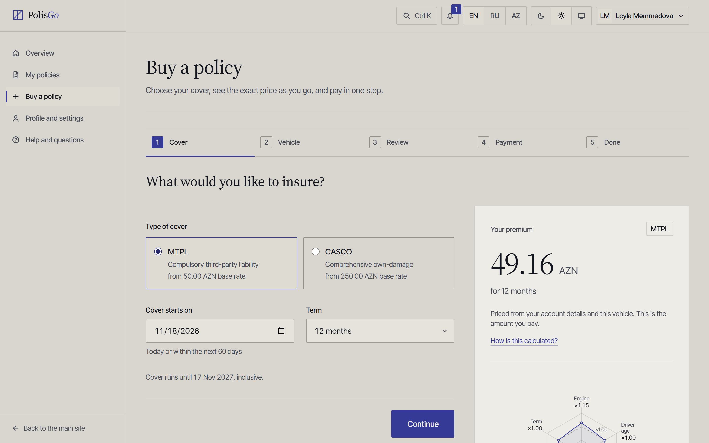
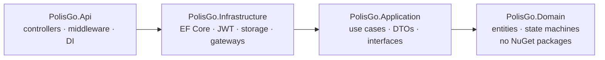

# PolisGo

Motor insurance management API for Azerbaijan — quotes, policies, claims and
role-based access — built with ASP.NET Core 10 and Clean Architecture, with a
React frontend.

[](https://github.com/ibrahimesh/PolisGo/actions/workflows/ci.yml)


| Dark (default)                                                              | Light                                                                         |
| --------------------------------------------------------------------------- | ----------------------------------------------------------------------------- |
|  |  |
|  |  |

## What it is

A REST API for running motor insurance (MTPL and CASCO): customers register
vehicles, get a priced quote, buy and pay for policies, and file claims that
adjusters review, approve or reject and pay out. Four roles — Client, Agent,
Adjuster, Admin — each see only the data they are allowed to. **Tariffs, base
rates and coverage are illustrative**; this is a portfolio project, not a real
insurance product, and payments go through fake gateways.

## Features

**Anyone (no account)** — premium quote with a factor-by-factor breakdown;
product catalogue (`/api/policy-types`); health check.

**Client**
- Register (email, Azerbaijani phone normalised to E.164, password policy,
  18+) and sign in; JWT-based session.
- Register vehicles; buy a policy for one — the premium is recalculated on the
  server from stored data, including approved or paid claims of the last three
  years; start date within 60 days; no overlapping policy of the same type.
- Live quote from stored data (`POST /api/policies/quote`): the same calculation
  as issuing, so the quoted premium is the charged premium.
- Pay a policy (Draft → Active) or cancel it; submit claims on own policies,
  upload JPG/PNG/PDF documents (≤ 5 MB, ≤ 10 per claim), follow the status
  history. Sees only their own vehicles, policies and claims.
- Policy list with status/type filters, search by number or plate and sorting;
  policy detail with the pricing frozen at issue, payments and status history.
- Profile (`/api/me`): edit name and phone, change password. Overview figures
  and renewal reminders (active policies ending within 30 days) with read
  marks.

**Agent** — registers vehicles, issues and takes payment for policies, and
files claims on behalf of a customer; sees only the policies they sold and the
claims on them; searchable, paged customer directory.

**Adjuster** — claims queue (unassigned and own); start review (assigns the
claim), approve an amount up to the claimed sum, reject with a reason, mark
paid. Only the assigned adjuster (or an Admin) can decide. Customer directory.

**Admin** — all of the above; creates Agent and Adjuster accounts; dashboard
statistics (policies and claims by status, premium written, claims paid, 12
months of activity, average claim resolution time).

**Frontend** (`frontend/`) — landing page with the live calculator and an
API-driven coverage table, validated sign-in and registration, EN / RU / AZ,
dark and light themes, Ctrl/⌘+K palette; design system in
[frontend/DESIGN.md](frontend/DESIGN.md).

**Client cabinet** (`/app`) — sidebar on desktop, bottom bar on phones:
- **Overview**: active policies, next renewal, insured vehicles, premiums paid
  in 12 months, recent activity, renewal reminders.
- **My policies**: filters, search, sort and pages kept in the URL; policy
  detail with coverage, premium breakdown, payment and status history; a **PDF
  certificate** generated in the browser in EN / RU / AZ.
- **Buy a policy**: five-step wizard with the exact live premium, inline
  vehicle registration, review, payment through the demo gateway and a success
  screen; survives a reload; renew-a-policy and resume-a-draft links.
- **Notifications** panel for renewal reminders (unread badge, mark as read).
- **Profile and settings** (name, phone, password, language, theme) and
  **Help**.

Staff desks are not built yet ([Roadmap](#roadmap)).

## Architecture



Arrows are project references; dependencies point inward only. The domain
rules that matter most — the claim workflow and policy lifecycle — live in
plain C# with no framework dependencies, so they are unit-tested without a
database, and persistence is swappable (SQL Server in production, SQLite in
tests). Project rules: [CLAUDE.md](CLAUDE.md).

```text
src/
  PolisGo.Domain/          entities, enums, state transitions
  PolisGo.Application/     services per feature (Auth, Policies, Claims, Pricing, …)
  PolisGo.Infrastructure/  AppDbContext, configurations, migrations, JWT, storage
  PolisGo.Api/             controllers, exception middleware, Program.cs
tests/PolisGo.Tests/       xUnit: service tests (SQLite) and HTTP tests
frontend/                  React SPA, Playwright e2e, DESIGN.md
```

## Tech stack

| Area     | Choice                                                                                   |
| -------- | ---------------------------------------------------------------------------------------- |
| Backend  | .NET 10, ASP.NET Core controllers, EF Core 10, JWT Bearer, BCrypt, Swashbuckle            |
| Database | SQL Server 2022 (Docker) or LocalDB (local development)                                  |
| Frontend | React 19, TypeScript (strict), Vite, Tailwind CSS 4, React Router, TanStack Query, React Hook Form + Zod, react-i18next |
| Testing  | xUnit, SQLite in-memory, WebApplicationFactory; Vitest + Testing Library; Playwright + axe-core |
| CI/CD    | GitHub Actions: backend, frontend and Docker image build                                 |
| Docker   | Multi-stage API image; `docker-compose.yml` with SQL Server and health checks             |

## Key engineering decisions

- **JWT with roles, plus row-level visibility.** Tokens carry the role and,
  for clients, a customer id ([JwtTokenGenerator.cs](src/PolisGo.Infrastructure/Auth/JwtTokenGenerator.cs));
  `[Authorize(Roles = …)]` gates each endpoint, and
  [PolicyAccess.cs](src/PolisGo.Application/Policies/PolicyAccess.cs) /
  [ClaimAccess.cs](src/PolisGo.Application/Claims/ClaimAccess.cs) filter rows,
  so another user's record is a 404, never a 403 that leaks its existence.
- **State machines with an audit trail.** Claim transitions
  (`StartReview`, `Approve`, `Reject`, `MarkPaid`) live on the entity and each
  one appends a `ClaimStatusHistory` row
  ([Claim.cs](src/PolisGo.Domain/Entities/Claim.cs));
  policies have `Activate` / `Cancel` ([Policy.cs](src/PolisGo.Domain/Entities/Policy.cs)),
  which append `PolicyStatusHistory` rows. Illegal transitions throw and become 409.
- **Prices you can explain later.** The tariff factors are frozen on the
  policy at issue (an owned `PolicyPricing`), because recomputing them later
  would use a different age, claims history or tariff. The quote and create
  endpoints share one pricing path, so the quoted premium is the charged one.
- **Expiry is derived, not scheduled.** An Active policy past its inclusive
  end date reads and filters as Expired
  ([PolicyStatusFilter.cs](src/PolisGo.Application/Policies/PolicyStatusFilter.cs)),
  and a Draft whose start date has passed can no longer be paid (no backdated
  cover).
- **Certificates rendered in the browser** with pdf-lib + fontkit (MIT) and
  the app's own fonts (OFL), so they come out in the user's language with no
  server-side translation. The code loads only on Download.
- **Optimistic concurrency.** `Claim.RowVersion` is a GUID regenerated on
  every transition and mapped as a concurrency token
  ([ClaimConfiguration.cs](src/PolisGo.Infrastructure/Persistence/Configurations/ClaimConfiguration.cs));
  a stale update returns 409. A GUID instead of `rowversion` keeps it portable
  to the SQLite test database.
- **ProblemDetails with traceId.** One middleware maps every exception to an
  RFC 7807 response (`application/problem+json`) with field errors and a
  `traceId`; 500s hide details outside Development
  ([ExceptionHandlingMiddleware.cs](src/PolisGo.Api/Middleware/ExceptionHandlingMiddleware.cs)).
- **Cross-platform file-name sanitiser.** `Path.GetFileName` ignores `\` on
  Linux, so [FileNames.cs](src/PolisGo.Application/Common/FileNames.cs)
  normalises both separators before stripping paths; files are stored under
  server-generated GUID names ([LocalFileStorage.cs](src/PolisGo.Infrastructure/Storage/LocalFileStorage.cs)).
- **Migrations on startup behind a flag.** `Database:ApplyMigrationsOnStartup`
  (on in docker-compose) applies migrations with a retry loop for SQL Server's
  warm-up ([Program.cs](src/PolisGo.Api/Program.cs)).
- **CORS without wildcards.** Origins come from `Cors:AllowedOrigins`; a `*`
  fails startup, and credentials stay off because the SPA sends a Bearer
  header ([Program.cs](src/PolisGo.Api/Program.cs)).
- **Pricing as a pure function** of its input, including the as-of date;
  coefficients live in one place ([Tariff.cs](src/PolisGo.Application/Pricing/Tariff.cs)).
- **Validation enforced twice**: in the browser and in
  [AuthValidation.cs](src/PolisGo.Application/Auth/AuthValidation.cs); a
  frontend test fails if a server message has no translation.

## Quick start (Docker)

Requires Docker with Compose and, for the frontend, Node.js 22+.

```bash
cp .env.example .env
```

Edit `.env`: `SQL_SA_PASSWORD` needs 8+ characters with three of upper case,
lower case, digit, symbol; `JWT_SECRET_KEY` needs 32+ characters or the API
refuses to start (`openssl rand -base64 48`); `SEED_ADMIN_EMAIL` and
`SEED_ADMIN_PASSWORD` define the admin created on first start.

```bash
docker compose up --build
```

API http://localhost:8080 (no page at `/`) · Swagger
http://localhost:8080/swagger (sign in with `POST /api/auth/login`, then
**Authorize**) · health http://localhost:8080/health

Frontend, in a second terminal:

```bash
cd frontend
npm ci
npm run dev
```

Open http://localhost:5173. The port is fixed because the API's CORS list
allows only `:5173` and `:3000`.

## Local development (without Docker)

Requires the .NET 10 SDK, SQL Server LocalDB (Windows; the connection string
is in `appsettings.Development.json`), the `dotnet-ef` tool
(`dotnet tool install --global dotnet-ef`) and Node.js 22+.

```bash
dotnet user-secrets set "Jwt:SecretKey" "$(openssl rand -base64 48)" --project src/PolisGo.Api
dotnet user-secrets set "Seed:AdminEmail" "admin@polisgo.local" --project src/PolisGo.Api
dotnet user-secrets set "Seed:AdminPassword" "ChangeMe_Admin1!" --project src/PolisGo.Api
dotnet restore PolisGo.slnx
dotnet ef database update -p src/PolisGo.Infrastructure -s src/PolisGo.Api
dotnet run --project src/PolisGo.Api --launch-profile http
```

The API listens on http://localhost:5058 (Swagger at `/swagger`). To use
another SQL Server, set the `ConnectionStrings__Default` environment variable.

Point the frontend at it, then start it as above:

```bash
cd frontend
echo "VITE_API_BASE_URL=http://localhost:5058" > .env.local
npm ci
npm run dev
```

In Windows PowerShell use
`Set-Content .env.local "VITE_API_BASE_URL=http://localhost:5058" -Encoding ascii`
instead of `echo` — its redirect writes UTF-16, which Vite does not read.

## Testing

```bash
dotnet test PolisGo.slnx
```

**334 backend tests** (xUnit): domain and service tests on SQLite in-memory
and HTTP tests via `WebApplicationFactory` (401/403/404 per role, JSON contract,
and one client reading, paying or searching for another's policy → 404).

```bash
cd frontend
npm test
npx playwright install chromium
npm run e2e
```

**184 frontend unit tests** (Vitest) and **58 end-to-end tests** (Playwright +
axe-core: 45 at 1440px, plus the 13 cabinet tests again at 390px) against the
real API — the e2e suite needs the Docker stack on `:8080`. They cover
sign-up and sign-in, buying a policy end to end, the certificate download,
renewal, notifications, profile and password changes, negative validation on
the client and the server, forbidden staff routes and another client's policy,
the live calculator, languages, and axe checks on every page in both themes.

## CI

[`.github/workflows/ci.yml`](.github/workflows/ci.yml) runs on pushes and pull
requests to `main`:

- **Build and test** — Release build with warnings as errors, all backend tests
  with coverage (TRX and Cobertura uploaded as artifacts).
- **Frontend** — Node 22, `npm ci`, lint, typecheck, Vitest, production build.
- **Docker build** — builds the API image with Buildx (not pushed). E2E is not
  in CI yet.

## API overview

Generated from the controllers; full schemas in Swagger.

| Method | Path | Access |
| ------ | ---- | ------ |
| POST | `/api/auth/register`, `/api/auth/login` | Anonymous |
| GET | `/api/auth/me` | Signed in |
| GET, PUT | `/api/me` | Signed in (own profile) |
| POST | `/api/me/change-password` | Signed in |
| GET | `/api/me/overview`, `/api/me/reminders` | Client |
| POST | `/api/me/reminders/{policyId}/read`, `/api/me/reminders/read-all` | Client |
| POST | `/api/quotes/calculate` | Anonymous |
| GET | `/api/policy-types` | Anonymous |
| GET, POST | `/api/vehicles` | Signed in (Clients: own only) |
| POST | `/api/policies/quote`, `/api/policies` | Client, Agent, Admin |
| GET | `/api/policies`, `/api/policies/{id}` | Signed in, row-filtered |
| POST | `/api/policies/{id}/pay` | Client, Agent, Admin |
| POST | `/api/policies/{id}/cancel` | Signed in, row-filtered |
| POST | `/api/claims` | Client, Agent, Admin |
| GET | `/api/claims`, `/api/claims/{id}`, `/api/claims/{id}/history` | Signed in, row-filtered |
| POST | `/api/claims/{id}/documents` | Signed in, row-filtered |
| GET | `/api/claims/{id}/documents/{docId}` | Signed in, row-filtered |
| POST | `/api/claims/{id}/review`, `/approve`, `/reject`, `/pay` | Adjuster, Admin |
| GET | `/api/customers`, `/api/customers/{id}` | Admin, Agent, Adjuster |
| POST | `/api/users/staff` | Admin |
| GET | `/api/admin/stats` | Admin |
| GET | `/health` | Anonymous |

## Roadmap

Not done yet:

- Claims in the client cabinet (the API supports them), the adjuster claims
  desk, agent desk and admin panel — those routes are still placeholders.
- A scheduled job that stores `Expired` (today it is derived from the end
  date on every read) and server-side language/theme preferences.
- Revoking other sessions on a password change (tokens live up to 60 minutes).
- Real payment and payout providers instead of the fake gateways.
- Refresh tokens (sessions are a single 60-minute access token).
- Running the e2e suite in CI.

## Author

Ibrahim Shirinov —
[GitHub](https://github.com/ibrahimesh) ·
[LinkedIn](https://www.linkedin.com/in/ibrahim-shirinov-131516422)
