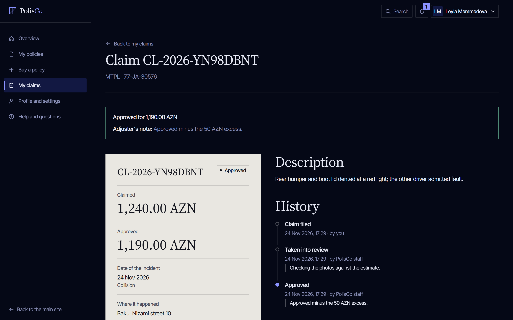
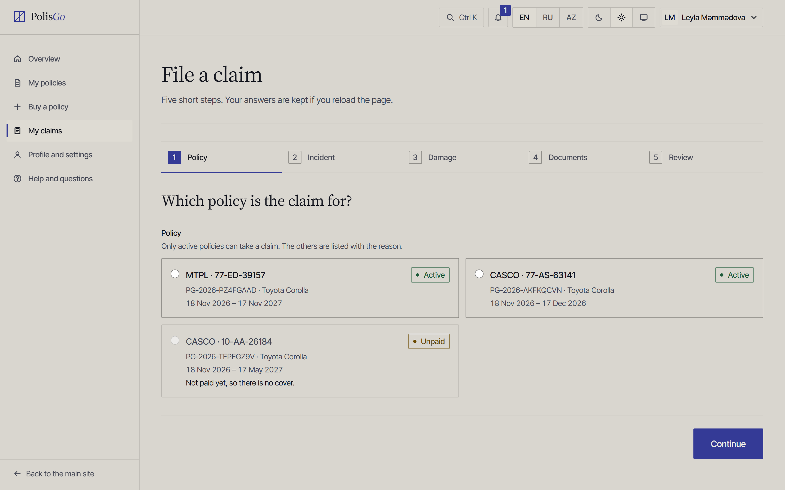
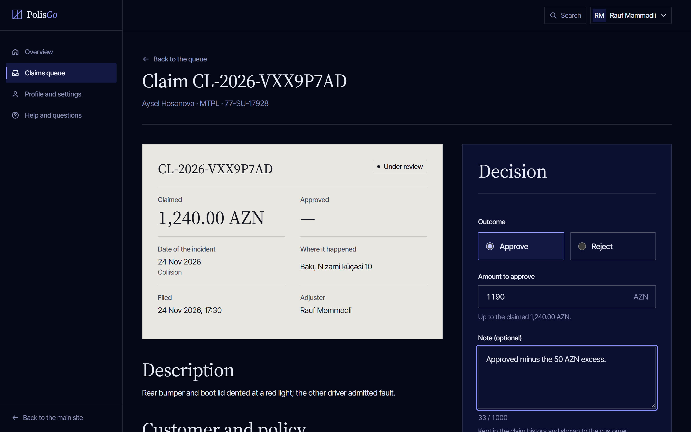
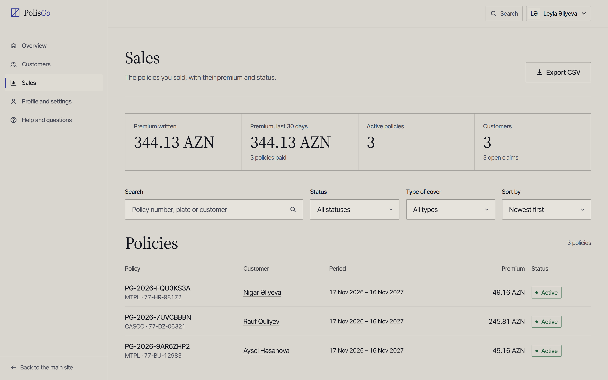
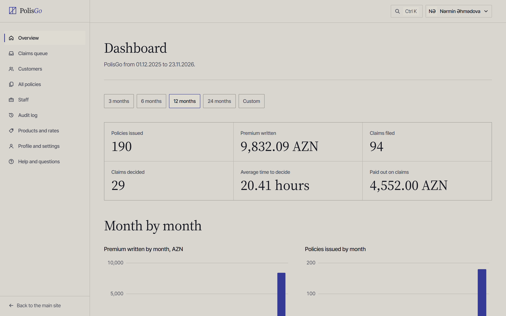
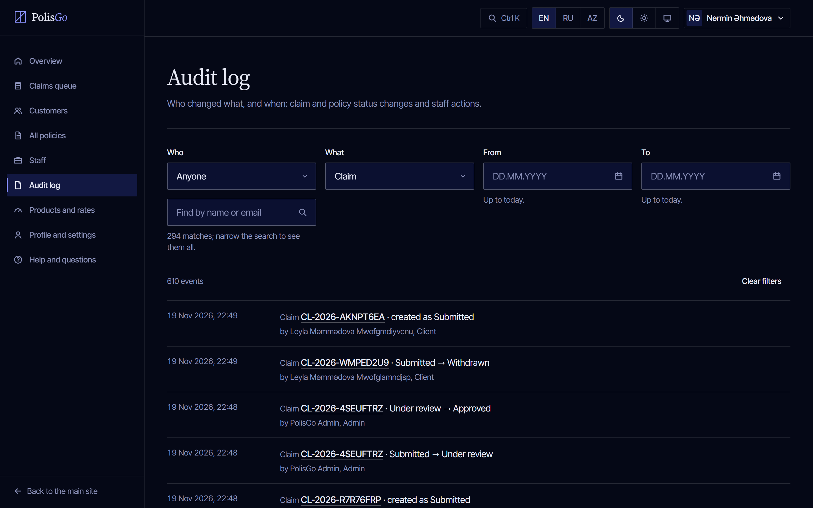
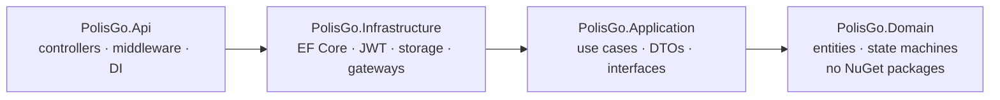

# PolisGo

Motor insurance management API for Azerbaijan — quotes, policies, claims and
role-based access — built with ASP.NET Core 10 and Clean Architecture, with a
React frontend.

[](https://github.com/ibrahimesh/PolisGo/actions/workflows/ci.yml)


| Dark (default)                                                              | Light                                                                         |
| --------------------------------------------------------------------------- | ----------------------------------------------------------------------------- |
|  |  |
|  |  |
|  |  |
|  |  |
|  |  |

## What it is

A REST API for running motor insurance (MTPL and CASCO): customers register
vehicles, get a priced quote, buy and pay for policies, and file claims that
adjusters review, approve or reject and pay out. Four roles — Client, Agent,
Adjuster, Admin — each see only the data they are allowed to. **Tariffs, base
rates and coverage are illustrative**; this is a portfolio project, not a real
insurance product, and payments go through fake gateways.

## Features

**Anyone (no account)** — premium quote with a factor-by-factor breakdown;
product catalogue (`/api/policy-types`); health check.

**Client**
- Register (email, Azerbaijani phone normalised to E.164, password policy,
  18+) and sign in; JWT-based session.
- Register vehicles; buy a policy for one — the premium is recalculated on the
  server from stored data, including approved or paid claims of the last three
  years; start date within 60 days; no overlapping policy of the same type.
- Live quote from stored data (`POST /api/policies/quote`): the same calculation
  as issuing, so the quoted premium is the charged premium.
- Pay a policy (Draft → Active) or cancel it; file claims on own active
  policies (incident date inside the cover, type, location, description,
  amount ≤ 50,000 AZN), upload JPG/PNG/PDF documents (≤ 5 MB, ≤ 10 per claim,
  checked by their first bytes) while the claim is open, follow the status
  history, withdraw a claim before a decision. Sees only their own vehicles,
  policies and claims.
- Claim list with status (or "open") filter, search by claim or policy number
  and sorting; claim updates (status changes made by staff) with read marks.
- Policy list with status/type filters, search by number or plate and sorting;
  policy detail with the pricing frozen at issue, payments and status history.
- Profile (`/api/me`): edit name and phone, change password. Overview figures
  and renewal reminders (active policies ending within 30 days) with read
  marks.

**Agent** — works their own book: the customers an Admin assigned to them
(`Customer.AgentId`), never another agent's (404). Registers vehicles for
them, sells and takes payment for policies, files and withdraws claims; reads
every policy and claim of their book's customers, whoever sold it, and keeps
read-only sight of what they sold to customers since moved to another agent
(only the current agent acts for a customer). Sales figures and a CSV export
of their own sales.

**Adjuster** — claims queue (unassigned and own); start review (assigns the
claim), approve an amount up to the claimed sum (two decimals), reject with a
required reason, pay out. Only the assigned adjuster (or an Admin) can decide.
Decisions carry the claim's `rowVersion`: a decision made on a version
someone else has changed is a 409 "Concurrent update". The claim detail lists
every action with the reason it is unavailable. Sees customers and policies
only through claims in reach, not the agents' books, and cannot cancel a
policy. CSV export of the queue.

**Admin** — all of the above; manages staff accounts (create Agent,
Adjuster or Admin with the registration rules; deactivate, reactivate;
change role), never their own account and never the last active admin;
assigns customers to agents; reads the dashboard for any period up to 24
months and the audit log. Every staff account carries a security stamp in its
token, checked on each request: deactivation or a role change ends that
person's open sessions at once, and a deactivated account can't sign in.
Staff actions (creation, deactivation, reactivation, role changes, customer
assignment) are recorded in the audit log from this release on.

**Frontend** (`frontend/`) — landing page with the live calculator and an
API-driven coverage table, validated sign-in and registration, EN / RU / AZ,
dark and light themes, Ctrl/⌘+K palette; design system in
[frontend/DESIGN.md](frontend/DESIGN.md).

**Client cabinet** (`/app`) — sidebar on desktop, bottom bar on phones:
- **Overview**: active policies, next renewal, insured vehicles, premiums paid
  in 12 months, recent activity, renewal reminders, open claims and the
  latest claim update.
- **My policies**: filters, search, sort and pages kept in the URL; policy
  detail with coverage, premium breakdown, payment and status history; a **PDF
  certificate** generated in the browser in EN / RU / AZ.
- **Buy a policy**: five-step wizard with the exact live premium, inline
  vehicle registration, review, payment through the demo gateway and a success
  screen; survives a reload; renew-a-policy and resume-a-draft links.
- **My claims**: filters, search, sort and pages in the URL, cards on phones.
  **File a claim**: five steps (policy, incident, damage, documents, review),
  ineligible policies shown disabled with the reason, drag-and-drop photo and
  PDF upload with previews and per-file progress, answers and picked files
  kept across a reload. **Claim page**: timeline from the audit history,
  the adjuster's decision, documents with download, more uploads while open,
  withdraw with a confirmation.
- **Notifications** panel for claim updates and renewal reminders (unread
  badge, mark as read). Nothing is sent by phone or email, and the UI says so.
- **Profile and settings** (name, phone, password, language, theme) and
  **Help**.

**Staff desks** (`/app` for Agent, Adjuster, Admin) — the same shell, with
only the role's own sections in the sidebar, bottom bar and palette:
- **Overview** from `GET /api/staff/overview`: claims waiting, in review and
  to pay, decisions in 30 days and the latest ones; premium written, policies
  sold and the latest sales.
- **Claims queue** (Adjuster, Admin): "waiting for review", "in my review",
  "approved, to pay out" and "all" views with counts; search by claim, policy
  or customer; sort (oldest first by default) and pages in the URL; age
  flagged after a week; cards on phones; **Export CSV**.
- **Claim review**: summary, customer and policy, documents with an in-page
  image/PDF preview, the full timeline, and the decision panel (start review,
  approve, reject with a reason, pay out, and why each unavailable step is
  unavailable). A conflicting change reloads the claim and keeps the draft
  note.
- **Customers** (Agent, Admin): search by name, email or phone digits; detail
  with vehicles, policies and claims; **Sell a policy** on the customer's
  behalf with the purchase wizard's rules and live premium, a new vehicle on
  the spot, and payment now or later.
- **Sales** (Agent, Admin): figures, the policy list with filters and **Export
  CSV** (UTF-8 with BOM, formula-safe text cells).
- **Help**: how decisions work and what each claim status means.

**Admin panel** — the Admin's `/app` is a **dashboard** for a chosen period
(3 to 24 months or custom): totals, premium, policies and claims by month as
accessible charts (hover and arrow-key values, a data table each), claims by
status and top agents. **Staff**: search, role and status filters, create in a
dialog, role change and deactivation behind a confirm that says what follows.
**Customers** with an agent filter and assignment. **All policies** with who
sold them, an agent filter and CSV. **Claims** with incident-date filters.
**Audit log** filtered by person, type and dates. **Products and rates**,
read-only. Help has an admin section.

**DateField** — every date in the app is typed as DD.MM.YYYY in every
language (pasted ISO or day-first dates work too), with its own calendar in
EN/RU/AZ (arrow, Page and Home/End keys, month and year pickers); days
outside min/max are crossed out and the allowed range is written under the
field, e.g. "Must be within the cover period: from 1 Mar 2026 to today".

## Architecture



Arrows are project references; dependencies point inward only. The domain
rules that matter most — the claim workflow and policy lifecycle — live in
plain C# with no framework dependencies, so they are unit-tested without a
database, and persistence is swappable (SQL Server in production, SQLite in
tests). Project rules: [CLAUDE.md](CLAUDE.md).

```text
src/
  PolisGo.Domain/          entities, enums, state transitions
  PolisGo.Application/     services per feature (Auth, Policies, Claims, Pricing, …)
  PolisGo.Infrastructure/  AppDbContext, configurations, migrations, JWT, storage
  PolisGo.Api/             controllers, exception middleware, Program.cs
tests/PolisGo.Tests/       xUnit: service tests (SQLite) and HTTP tests
frontend/                  React SPA, Playwright e2e, DESIGN.md
```

## Tech stack

| Area     | Choice                                                                                   |
| -------- | ---------------------------------------------------------------------------------------- |
| Backend  | .NET 10, ASP.NET Core controllers, EF Core 10, JWT Bearer, BCrypt, Swashbuckle            |
| Database | SQL Server 2022 (Docker) or LocalDB (local development)                                  |
| Frontend | React 19, TypeScript (strict), Vite, Tailwind CSS 4, React Router, TanStack Query, React Hook Form + Zod, react-i18next |
| Testing  | xUnit, SQLite in-memory, WebApplicationFactory; Vitest + Testing Library; Playwright + axe-core |
| CI/CD    | GitHub Actions: backend, frontend and Docker image build                                 |
| Docker   | Multi-stage API image; `docker-compose.yml` with SQL Server and health checks             |

## Key engineering decisions

- **JWT with roles, plus row-level visibility.** Tokens carry the role and,
  for clients, a customer id ([JwtTokenGenerator.cs](src/PolisGo.Infrastructure/Auth/JwtTokenGenerator.cs));
  `[Authorize(Roles = …)]` gates each endpoint, and
  [PolicyAccess.cs](src/PolisGo.Application/Policies/PolicyAccess.cs) /
  [ClaimAccess.cs](src/PolisGo.Application/Claims/ClaimAccess.cs) filter rows,
  so another user's record is a 404, never a 403 that leaks its existence.
- **State machines with an audit trail.** Claim transitions
  (`StartReview`, `Approve`, `Reject`, `MarkPaid`) live on the entity and each
  one appends a `ClaimStatusHistory` row
  ([Claim.cs](src/PolisGo.Domain/Entities/Claim.cs));
  policies have `Activate` / `Cancel` ([Policy.cs](src/PolisGo.Domain/Entities/Policy.cs)),
  which append `PolicyStatusHistory` rows. Illegal transitions throw and become 409.
- **Prices you can explain later.** The tariff factors are frozen on the
  policy at issue (an owned `PolicyPricing`), because recomputing them later
  would use a different age, claims history or tariff. The quote and create
  endpoints share one pricing path, so the quoted premium is the charged one.
- **Expiry is derived, not scheduled.** An Active policy past its inclusive
  end date reads and filters as Expired
  ([PolicyStatusFilter.cs](src/PolisGo.Application/Policies/PolicyStatusFilter.cs)),
  and a Draft whose start date has passed can no longer be paid (no backdated
  cover).
- **Certificates rendered in the browser** with pdf-lib + fontkit (MIT) and
  the app's own fonts (OFL), so they come out in the user's language with no
  server-side translation. The code loads only on Download.
- **Optimistic concurrency.** `Claim.RowVersion` is a GUID regenerated on
  every transition and mapped as a concurrency token
  ([ClaimConfiguration.cs](src/PolisGo.Infrastructure/Persistence/Configurations/ClaimConfiguration.cs));
  a stale update returns 409. A GUID instead of `rowversion` keeps it portable
  to the SQLite test database.
- **ProblemDetails with traceId.** One middleware maps every exception to an
  RFC 7807 response (`application/problem+json`) with field errors and a
  `traceId`; 500s hide details outside Development
  ([ExceptionHandlingMiddleware.cs](src/PolisGo.Api/Middleware/ExceptionHandlingMiddleware.cs)).
- **Cross-platform file-name sanitiser.** `Path.GetFileName` ignores `\` on
  Linux, so [FileNames.cs](src/PolisGo.Application/Common/FileNames.cs)
  normalises both separators before stripping paths; files are stored under
  server-generated GUID names ([LocalFileStorage.cs](src/PolisGo.Infrastructure/Storage/LocalFileStorage.cs)).
- **Migrations on startup behind a flag.** `Database:ApplyMigrationsOnStartup`
  (on in docker-compose) applies migrations with a retry loop for SQL Server's
  warm-up ([Program.cs](src/PolisGo.Api/Program.cs)).
- **CORS without wildcards.** Origins come from `Cors:AllowedOrigins`; a `*`
  fails startup, and credentials stay off because the SPA sends a Bearer
  header ([Program.cs](src/PolisGo.Api/Program.cs)).
- **Pricing as a pure function** of its input, including the as-of date;
  coefficients live in one place ([Tariff.cs](src/PolisGo.Application/Pricing/Tariff.cs)).
- **Validation enforced twice**: in the browser and in
  [AuthValidation.cs](src/PolisGo.Application/Auth/AuthValidation.cs); a
  frontend test fails if a server message has no translation.

## Quick start (Docker)

Requires Docker with Compose and, for the frontend, Node.js 22+.

```bash
cp .env.example .env
```

Edit `.env`: `SQL_SA_PASSWORD` needs 8+ characters with three of upper case,
lower case, digit, symbol; `JWT_SECRET_KEY` needs 32+ characters or the API
refuses to start (`openssl rand -base64 48`); `SEED_ADMIN_EMAIL` and
`SEED_ADMIN_PASSWORD` define the admin created on first start.

```bash
docker compose up --build
```

API http://localhost:8080 (no page at `/`) · Swagger
http://localhost:8080/swagger (sign in with `POST /api/auth/login`, then
**Authorize**) · health http://localhost:8080/health

Frontend, in a second terminal:

```bash
cd frontend
npm ci
npm run dev
```

Open http://localhost:5173. The port is fixed because the API's CORS list
allows only `:5173` and `:3000`.

### Demo data (optional)

> **Demo accounts, not for production.** The demo data is fake people, cars,
> policies and claims for trying the app out.

```bash
docker compose -f docker-compose.yml -f docker-compose.demo.yml up --build
```

On first start the API adds demo agents, adjusters and clients, their
vehicles, policies started months ago with their payments, and claims in every
status with their history. It runs once per database (a marker account), and
**refuses to run when `ASPNETCORE_ENVIRONMENT` is `Production`**. The flag is
`Demo__SeedData=true` if you set it another way.

All demo accounts share one password: `DEMO_PASSWORD` from `.env`, or
`Demo-Passw0rd` when it is not set (never the admin password). Sign in as,
for example:

| Account | Role |
| ------- | ---- |
| `demo.agent1@demo.polisgo.az` (Leyla Əliyeva) | Agent, four customers |
| `demo.agent2@demo.polisgo.az` (Tural Hüseynov) | Agent, three customers |
| `demo.adjuster1@demo.polisgo.az` (Rauf Məmmədli) | Adjuster |
| `demo.aysel@demo.polisgo.az` (Aysel Həsənova) | Client |

The admin is still the one from `SEED_ADMIN_EMAIL`.

## Local development (without Docker)

Requires the .NET 10 SDK, SQL Server LocalDB (Windows; the connection string
is in `appsettings.Development.json`), the `dotnet-ef` tool
(`dotnet tool install --global dotnet-ef`) and Node.js 22+.

```bash
dotnet user-secrets set "Jwt:SecretKey" "$(openssl rand -base64 48)" --project src/PolisGo.Api
dotnet user-secrets set "Seed:AdminEmail" "admin@polisgo.local" --project src/PolisGo.Api
dotnet user-secrets set "Seed:AdminPassword" "ChangeMe_Admin1!" --project src/PolisGo.Api
dotnet restore PolisGo.slnx
dotnet ef database update -p src/PolisGo.Infrastructure -s src/PolisGo.Api
dotnet run --project src/PolisGo.Api --launch-profile http
```

The API listens on http://localhost:5058 (Swagger at `/swagger`). To use
another SQL Server, set the `ConnectionStrings__Default` environment variable.

Point the frontend at it, then start it as above:

```bash
cd frontend
echo "VITE_API_BASE_URL=http://localhost:5058" > .env.local
npm ci
npm run dev
```

In Windows PowerShell use
`Set-Content .env.local "VITE_API_BASE_URL=http://localhost:5058" -Encoding ascii`
instead of `echo` — its redirect writes UTF-16, which Vite does not read.

## Testing

```bash
dotnet test PolisGo.slnx
```

**449 backend tests** (xUnit): domain and service tests on SQLite in-memory
and HTTP tests via `WebApplicationFactory` (401/403/404 per role, JSON contract,
and one client reading, paying, searching, uploading to or withdrawing
another's policy or claim → 404; a client on every staff endpoint → 403, an
agent deciding → 403, one agent's customers hidden from another and from
adjusters, decision field rules, stale decisions → 409, CSV escaping).

```bash
cd frontend
npm test
npx playwright install chromium
npm run e2e
```

**309 frontend unit tests** (Vitest) and **146 end-to-end tests** (Playwright +
axe-core: 78 at 1440px, plus the 36 cabinet and staff tests again at 390px) against the
real API — the e2e suite needs the Docker stack on `:8080`. They cover
sign-up and sign-in, buying a policy end to end, the certificate download,
renewal, filing a claim with photos, withdrawing it, the claim timeline after
an adjuster's decision, a keyboard-only claim, notifications, profile and
password changes, negative validation on the client and the server (including
a tampered request), forbidden staff routes and another client's policy or
claim, field-length limits against SQL Server, the live calculator, languages,
and axe checks on every page in both themes. Staff: an adjuster approving and
paying out, a rejection that needs a reason, a decision from a second session
on a stale claim, a tampered amount refused on its field, keyboard-only
decisions, the 403 page for each role, an agent seeing only their own
customers and selling through to payment, and both CSV exports. Admin: the
dashboard on demo data, staff creation, deactivation refusing the next
sign-in, a role change ending the old session, your own account protected,
assignment seen by the agent and in the audit feed, the all-policies export,
the 403 page for every other role, and DateField typing, pasting, invalid
dates, the Azerbaijani calendar from the keyboard and the claim's allowed
days. The backend tests also check that a deactivated user's existing token
stops working and that the last active admin is kept.

## CI

[`.github/workflows/ci.yml`](.github/workflows/ci.yml) runs on pushes and pull
requests to `main`:

- **Build and test** — Release build with warnings as errors, all backend tests
  with coverage (TRX and Cobertura uploaded as artifacts).
- **Frontend** — Node 22, `npm ci`, lint, typecheck, Vitest, production build.
- **End-to-end** — `docker compose` starts SQL Server and the API (fresh
  database, migrations and the dev admin seed on start-up), then the full
  Playwright suite runs against it; on failure the HTML report, traces,
  screenshots and container logs are kept as artifacts.
- **Docker build** — builds the API image with Buildx (not pushed).

## API overview

Generated from the controllers; full schemas in Swagger.

| Method | Path | Access |
| ------ | ---- | ------ |
| POST | `/api/auth/register`, `/api/auth/login` | Anonymous |
| GET | `/api/auth/me` | Signed in |
| GET, PUT | `/api/me` | Signed in (own profile) |
| POST | `/api/me/change-password` | Signed in |
| GET | `/api/me/overview`, `/api/me/reminders`, `/api/me/claim-updates` | Client |
| POST | `/api/me/reminders/{policyId}/read`, `/api/me/reminders/read-all` | Client |
| POST | `/api/me/claim-updates/{claimId}/read`, `/api/me/claim-updates/read-all` | Client |
| POST | `/api/quotes/calculate` | Anonymous |
| GET | `/api/policy-types` | Anonymous |
| GET | `/api/vehicles` | Signed in (Clients: own; staff: customers in scope) |
| POST | `/api/vehicles` | Client, Agent, Admin (Agents: own customers) |
| POST | `/api/policies/quote`, `/api/policies` | Client, Agent, Admin |
| GET | `/api/policies`, `/api/policies/{id}` | Signed in, row-filtered (Adjusters: policies with a claim in reach) |
| GET | `/api/policies/export` (CSV, list filters) | Agent, Admin |
| POST | `/api/policies/{id}/pay` | Client, Agent, Admin |
| POST | `/api/policies/{id}/cancel` | Client, Agent, Admin; row-filtered |
| POST | `/api/claims` | Client, Agent, Admin |
| GET | `/api/claims` (status, open, search, sort, paged), `/api/claims/{id}`, `/api/claims/{id}/history` | Signed in, row-filtered |
| POST | `/api/claims/{id}/withdraw` | Client, Agent, Admin; row-filtered |
| POST | `/api/claims/{id}/documents` | Signed in, row-filtered |
| GET | `/api/claims/{id}/documents/{docId}` | Signed in, row-filtered |
| GET | `/api/claims/export` (CSV, list filters) | Adjuster, Admin |
| POST | `/api/claims/{id}/review`, `/approve`, `/reject`, `/pay` (with `rowVersion`) | Adjuster, Admin |
| GET | `/api/customers`, `/api/customers/{id}` | Admin, Agent (own book), Adjuster (claims in reach) |
| PUT | `/api/customers/{id}/agent` | Admin |
| GET | `/api/staff/overview` | Agent, Adjuster, Admin |
| GET, POST | `/api/users/staff` (list: search, role, status, paged) | Admin |
| POST | `/api/users/{id}/deactivate`, `/api/users/{id}/reactivate` | Admin |
| PUT | `/api/users/{id}/role` | Admin |
| GET | `/api/admin/stats` | Admin |
| GET | `/api/admin/dashboard` (from, to; 24 months max) | Admin |
| GET | `/api/admin/audit` (actor, entity type, from, to, paged) | Admin |
| GET | `/health` | Anonymous |

## Roadmap

Not done yet:

- Editing products and base rates (read-only; seeded with the database).
- Password resets for staff (an admin can deactivate and create; there is no
  reset email).
- Staff actions before this release were not recorded, so the audit log
  starts here for them (status history goes back to the start).
- "Request more information" from the customer: the claim state machine has
  no such step yet.
- Releasing or reassigning a claim another adjuster has taken.
- Agents taking on a brand-new customer themselves (an Admin assigns them).
- Email or SMS notifications; today updates and reminders live in the
  cabinet only.
- Malware scanning and object storage for claim documents (they are checked
  by type and first bytes and kept on a local volume).
- A scheduled job that stores `Expired` (today it is derived from the end
  date on every read) and server-side language/theme preferences.
- Revoking other sessions on a password change (tokens live up to 60 minutes).
- Real payment and payout providers instead of the fake gateways.
- Refresh tokens (sessions are a single 60-minute access token).

## Author

Ibrahim Shirinov —
[GitHub](https://github.com/ibrahimesh) ·
[LinkedIn](https://www.linkedin.com/in/ibrahim-shirinov-131516422)
